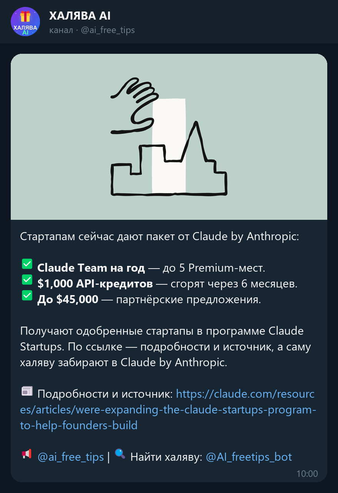
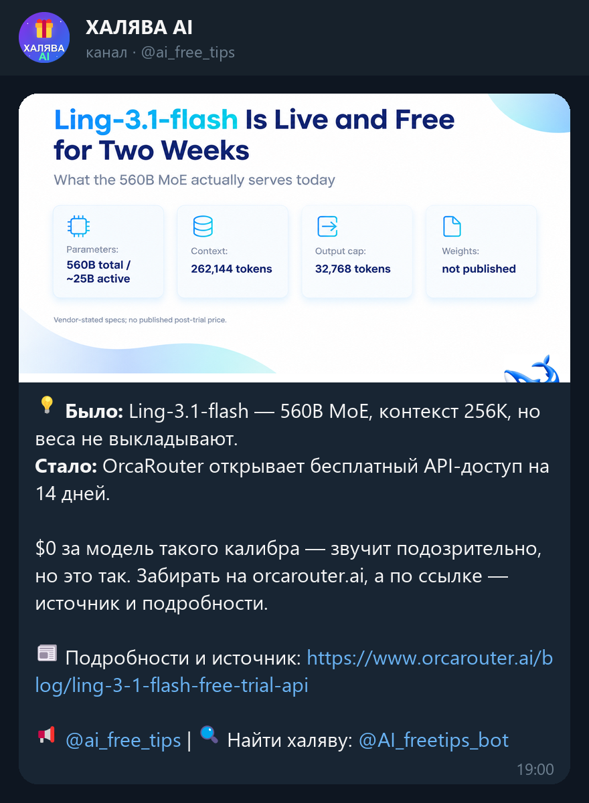
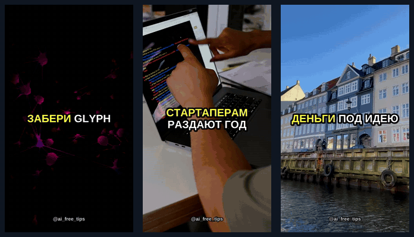
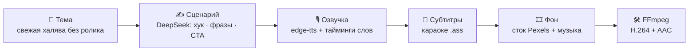
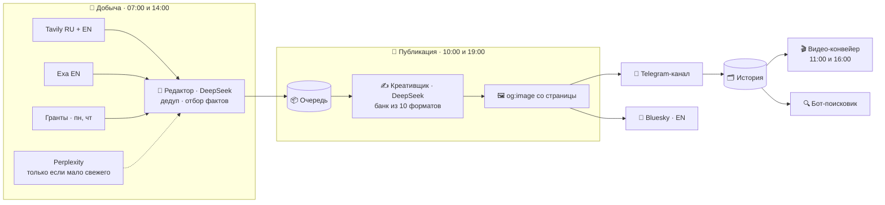

<div align="center">


# ХАЛЯВА AI

**Автономный ИИ-агент для Telegram-канала: сам находит бесплатные ИИ-инструменты,<br>пишет живые посты, клеит Shorts-ролики и публикует всё по расписанию.**

[](https://t.me/ai_free_tips)
[](https://t.me/AI_freetips_bot)
<br>


</div>

---

Бесплатные доступы к нейросетям, кредиты на API, промо-тарифы и гранты для ИИ-стартапов
появляются каждый день и так же быстро исчезают. Агент дважды в день прочёсывает новости
на русском и английском, отбирает свежие и непохожие друг на друга находки и превращает
каждую в пост для канала **[@ai_free_tips](https://t.me/ai_free_tips)**. Человек нужен
только для того, чтобы читать.

Бот работает в проде с июля 2026 года, за это время он опубликовал **200+ халяв**.

## ✨ Что умеет

- 🧠 **Три роли вместо одного промпта.** Ресёрчер собирает источники, редактор (DeepSeek, temp 0.2)
  выжимает сухие факты и отбирает разные темы, креативщик (temp 0.85) пишет из факта живой пост.
- 🎭 **Банк из 10 форматов и анти-повтор.** Каждый пост получает свою подачу. Креативщик видит
  последние посты канала и не повторяет их зачины, поэтому лента не выглядит штамповкой.
- 💸 **«Ленивый» Perplexity.** Tavily и Exa ищут первыми. Дорогой Perplexity подключается, только если
  они нашли меньше 12 свежих источников.
- 🔁 **Дедупликация.** Повторы отсекаются по нормализованным ссылкам за 30 дней и по смыслу заголовков.
- 🔗 **Честные ссылки.** Если ссылка ведёт на саму акцию, пост пишет «⚡ Забирай тут». Если на статью
  о ней, то «📰 Подробности и источник». Новостной сайт за сервис агент не выдаёт.
- 🖼 **Только оригинальная картинка.** Берётся `og:image` со страницы акции. Если её нет, выходит
  текстовый пост.
- 📦 **Очередь с TTL.** Добыча идёт по своим слотам, публикация по своим, по одному посту.
  Контент распределён по дню, протухшие находки выбрасываются.
- 🎬 **Shorts из каждой халявы.** Сценарий, озвучка, караоке-субтитры, сток, музыка и сборка
  в FFmpeg проходят без участия человека.
- 🦋 **Кросспостинг в Bluesky.** Посты и ролики переводятся на английский и уходят туда сами.
- 🔍 **Бот-поисковик.** Пишешь «нужна бесплатная генерация видео», бот ищет по базе опубликованных
  халяв. Отвечает только подписчикам канала.
- 🎓 **Гранты для ИИ-стартапов.** По понедельникам и четвергам добавляется отдельный поисковый поток.
- 🚨 **Алерты владельцу.** Если очередь опустела, добыча ничего не нашла или упал видео-конвейер,
  в личку приходит сообщение.

## 📰 Примеры постов

Все посты ниже настоящие, из канала. Текст, формат и ссылка взяты из истории публикаций бота,
картинка — оригинальный `og:image` со страницы источника.

<table>
<tr>
<td width="55%"></td>
<td>

### ✅ Чек-лист выгод

Выгода подаётся списком с галочками: что именно получишь, сухо и без воды.

Ссылка ведёт на статью, поэтому подпись честная: **«📰 Подробности и источник»**.

</td>
</tr>
<tr>
<td></td>
<td>

### 💡 Было / стало

Пост построен на контрасте «платно → бесплатно» или «раньше → сейчас».

Картинку агент не генерирует, а берёт оригинальную со страницы акции.

</td>
</tr>
<tr>
<td></td>
<td>

### ⏳ Дедлайн / FOMO

Упор на срочность, но без выдуманных сроков: если дата закрытия неизвестна, пост пишет
«раздача не вечная».

Ссылка ведёт на саму акцию, поэтому подпись **«⚡ Забирай тут»**.

</td>
</tr>
</table>

<details>
<summary><b>🎭 Все 10 форматов из банка (с реальными зачинами из канала)</b></summary>

<br>

| Формат | Как подаёт | Реальный зачин |
|---|---|---|
| 🔥 Хайп / эмоция | драйв, восклицания, эмодзи | «🛑 Стоп, срочно в календарь: Coderblock.ai открывает публичный доступ…» |
| 📖 Микро-история | мини-сюжет от первого лица | «😅 Захожу в настройки Notion, смотрю на ценник AI — и грущу.» |
| ❓ Вопрос-крючок | вопрос к боли читателя → решение | «Идея есть, а денег на запуск нет? 💸» |
| 🕵️ Интрига | выгода раскрывается не сразу | «Вот бывает: ИИ-помощник для кода, а подписку за него не просят.» |
| ✅ Чек-лист выгод | список с галочками | «✅ Claude Team на год — до 5 Premium-мест.» |
| ⏳ Дедлайн / FOMO | срочность без вранья | «⏳ Окно открыто, но это не навсегда.» |
| 💡 Было / стало | контраст «платно vs бесплатно» | «Было: … Стало: OrcaRouter открывает бесплатный API-доступ на 14 дней.» |
| 🔢 Цифра-крючок | конкретная цифра в первой строке | «256K контекста. $0. Лимиты плавают.» |
| 😎 Дерзкий короткий | 2–4 строки, как сообщение корешу | «🤫 Glyph Cluster втихую отдали на Vercel AI Gateway.» |
| 🧠 Экспертный | спокойно: почему выгодно и кому зайдёт | «Практическая заметка для тех, кто работает с API и не хочет платить за compute.» |

Внутри одной пачки форматы не повторяются, а недавно использованные агент старается обходить.

</details>

## 🎬 Shorts-ролики

<div align="center">

<br><sub>Кадры из роликов, которые конвейер собрал сам</sub>
</div>

<br>

Конвейер берёт самую свежую опубликованную халяву, по которой ещё нет ролика, и собирает
вертикальное видео 9:16:



- **Три формата по расписанию:** утром «классика», днём «разбор за 3 шага», в воскресенье
  днём «топ-3 халявы недели».
- **Субтитры как в вирусных Shorts:** крупные слова группами по 2–3, текущее слово подсвечено
  жёлтым, ключевые выделены зелёным. В конце плашка «забирай в Telegram».
- **Устойчивая озвучка.** Нейроголоса Microsoft иногда отдают пустой ответ. Тогда конвейер
  повторяет запрос, потом убирает ускорение речи, потом переключается на запасной голос.
- **Публикация.** Ролик уходит в канал, а владельцу в личку приходит он же с готовыми подписями
  для YouTube Shorts и TikTok: скопировал и выложил за минуту. В тест-режиме
  (`VIDEO_POST_TO_CHANNEL=false`) ролик идёт только в личку. Для Bluesky собирается отдельная
  полностью английская версия со своей озвучкой и субтитрами.

## ⚙️ Как это работает



Процессов два, оба крутятся в Docker:

| Процесс | Что делает |
|---|---|
| **`worker`** (`worker.py`) | Расписание на APScheduler: добыча в очередь, публикация по одному посту, Shorts-ролики. Время берётся по `TIMEZONE`, часовой пояс сервера роли не играет |
| **`userbot`** (`app/userbot.py`) | Telethon: бот-поисковик в личке бота, команды владельца `/report` (суточный отчёт) и `/scout` (поиск новых каналов через рекомендации Telegram), а также комментинг-помощник с подтверждением |

<details>
<summary><b>💬 Комментинг-помощник: как устроен</b></summary>

<br>

Юзербот следит за свежими постами в каналах-донорах. На каждый новый пост DeepSeek пишет два
варианта комментария, и бот присылает их владельцу с кнопками **[Вариант 1] [Вариант 2] [Пропустить]**.
Комментарий публикуется **только после клика**, с человекоподобной задержкой и **только от имени
канала** (`send_as`). Личный аккаунт при этом не светится.

Работают лимиты: в сутки, на канал и паузы между постами. Каналы, где в обсуждении сидит
бот-антиспам, `/scout` вообще не предлагает. Весь комментинг отключается одной переменной
`USERBOT_COMMENTING=false`, при этом бот-поисковик и команды продолжают работать.

</details>

## 🚀 Быстрый старт

### В Docker (как в проде)

```bash
git clone https://github.com/TimurPythonUser/ai-free-tips.git
cd ai-free-tips

cp .env.example .env        # впиши ключи, см. ниже
docker compose up -d --build
docker compose logs -f worker
```

Если юзербот не нужен, запусти только воркер: `docker compose up -d --build worker`.

Данные (очередь, история, ролики, лог) лежат в `./data` и монтируются в контейнер, поэтому
переживают пересборку. Ключи читаются из `.env` и в образ не запекаются.

### Локально с веб-панелью

```bash
pip install -r requirements.txt
python run.py               # http://127.0.0.1:8000
```

В панели видны живые логи и есть кнопки «Обновить» (добыть и сразу опубликовать) и «Ролик».
Авторизации у панели нет, поэтому наружу её не выставляй. В Docker она поднимается только
на localhost: `docker compose --profile panel up -d panel`.

### Юзербот (по желанию)

1. Возьми `TELEGRAM_API_ID` и `TELEGRAM_API_HASH` на [my.telegram.org](https://my.telegram.org) → API development tools.
2. Запусти `python login_userbot.py`, введи телефон и код. Скрипт выдаст строку сессии.
3. Впиши её в `.env` как `USERBOT_SESSION`. Строка даёт доступ к твоему аккаунту, никому её не показывай.

## 🔑 Настройки

Полный список с комментариями лежит в [`.env.example`](.env.example). Главное:

| Переменная | Зачем | По умолчанию |
|---|---|---|
| `TELEGRAM_BOT_TOKEN` | бот от @BotFather, **админ канала** с правом публикации | — |
| `TELEGRAM_CHANNEL` | куда постить | `@ai_free_tips` |
| `OWNER_CHAT_ID` | твой chat_id: сюда приходят ролики, отчёты и алерты | — |
| `DEEPSEEK_API_KEY` | редактор, креативщик, сценарист, переводы | — |
| `TAVILY_API_KEY` / `EXA_API_KEY` / `PERPLEXITY_API_KEY` | поиск, нужен хотя бы один | — |
| `HARVEST_TIME` | слоты добычи | `07:00,14:00` |
| `PUBLISH_TIMES` | слоты публикации, их число равно числу постов в день | `10:00,19:00` |
| `VIDEO_TIME` | слоты Shorts, пусто = выключено | — |
| `PEXELS_API_KEY` | сток для фона роликов, без ключа будет градиент | — |
| `VIDEO_POST_TO_CHANNEL` | `false`: ролик только в личку с подписями | `true` |
| `BLUESKY_HANDLE` / `BLUESKY_APP_PASSWORD` | кросспостинг в Bluesky | выкл |
| `TIMEZONE` | часовой пояс расписания | `Europe/Kyiv` |

## 🧰 Стек

| Задача | Чем |
|---|---|
| Мозг: отбор, тексты, сценарии, переводы | DeepSeek API |
| Поиск | Tavily, Exa (прямой HTTP), Perplexity `sonar-pro` как резерв |
| Публикация | Telegram Bot API (`httpx`), Bluesky AT Protocol без SDK |
| Юзербот и бот-поисковик | Telethon |
| Расписание | APScheduler |
| Озвучка | edge-tts (нейроголоса Microsoft) |
| Видео | FFmpeg (`imageio-ffmpeg`), ASS-субтитры, Pexels API |
| Веб-панель | FastAPI + Server-Sent Events |
| Деплой | Docker Compose |

## 📁 Структура

```
ai-free-tips/
├── worker.py              # автономный режим: всё по расписанию
├── run.py                 # локальная веб-панель
├── login_userbot.py       # разовый логин юзербота → USERBOT_SESSION
├── app/
│   ├── agent.py           # оркестратор: ресёрчер → редактор → очередь → публикатор
│   ├── search.py          # Tavily и Exa по HTTP
│   ├── prompts.py         # промпты поиска и редактора
│   ├── creative.py        # креативщик: банк форматов + анти-повтор
│   ├── telegram.py        # публикация в канал (фото + подпись / текст)
│   ├── images.py          # оригинальная картинка со страницы (og:image)
│   ├── store.py           # история, очередь, дедуп
│   ├── bluesky.py         # кросспостинг + перевод на английский
│   ├── userbot.py         # юзербот: комментинг, /report, /scout
│   ├── searchbot.py       # публичный бот-поисковик халявы
│   ├── commenting.py      # черновики комментов по веб-превью каналов
│   ├── notify.py          # алерты владельцу в личку
│   └── video/             # Shorts: сценарий → озвучка → субтитры → сток → сборка
├── web/                   # FastAPI-панель с живыми логами (SSE)
├── Dockerfile
└── docker-compose.yml     # worker + userbot (+ panel по профилю)
```

---

<div align="center">

Подписывайся на канал, там всё это работает вживую 👉 **[@ai_free_tips](https://t.me/ai_free_tips)**

</div>
